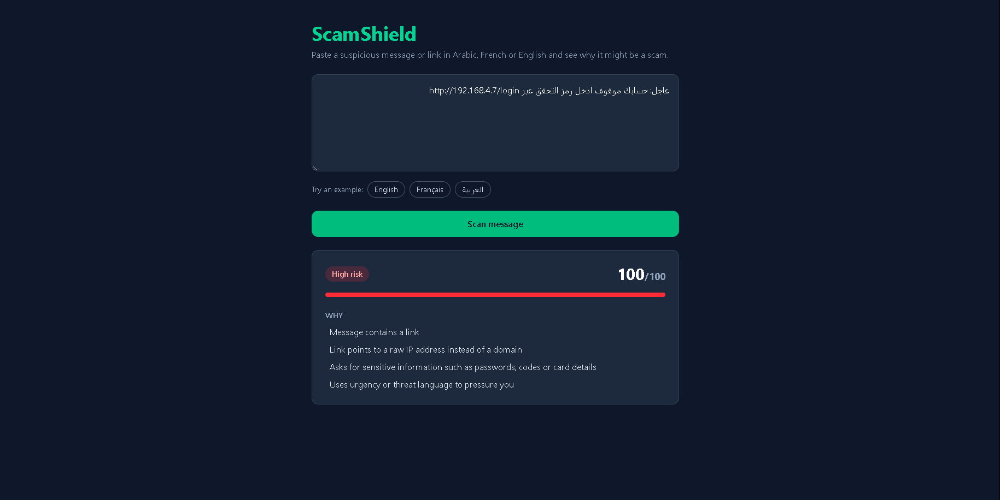

# ScamShield

Multilingual scam and phishing detector for **Arabic, French and English**. Paste a suspicious message or link and get a risk score with a plain-language explanation of *why* it looks like a scam.



## Why this project

Most scam checkers only handle English. In Tunisia and the wider Maghreb, scam messages (fake parcel deliveries, bank alerts, telecom prizes) are written in Arabic, French, or a mix of both. ScamShield is built to catch those.

## Features

- Risk score (0-100) with LOW / MEDIUM / HIGH levels
- Explainable results: every point of the score comes with a human-readable reason
- Arabic, French and English keyword detection, with text normalization (accents, Arabic diacritics, alef variants)
- Link analysis: URL shorteners, raw IP addresses, and domain extensions often used in scams
- Right-to-left input support in the UI
- Unit-tested detection engine

## Tech stack

| Layer | Technology |
|-------|------------|
| Backend | Java 21, Spring Boot, Maven |
| Frontend | React, Vite, Tailwind CSS |
| Testing | JUnit 5, AssertJ |

## How the detection engine works

Each rule is a small class implementing one interface:

```java
public interface DetectionRule {
    List<RuleResult> evaluate(String message);
}
```

`ScanService` runs every rule, adds up the points (capped at 100) and collects the reasons. Adding a new rule means adding one class annotated with `@Component`, and nothing else changes.

Current rules: `LinkRule`, `UrgencyRule`, `SensitiveInfoRule`.

## Getting started

**Requirements:** Java 21, Node.js 20.19+

**Backend**

```bash
cd backend
./mvnw spring-boot:run
```

The API runs on http://localhost:8080.

**Frontend**

```bash
cd frontend
npm install
npm run dev
```

The app runs on http://localhost:5173.

**Run the tests**

```bash
cd backend
./mvnw test
```

## API

`POST /api/scan`

```json
{ "message": "Votre colis bloqué, payez sous 24h : http://poste-tn.xyz/pay" }
```

Response:

```json
{
  "score": 65,
  "level": "MEDIUM",
  "reasons": [
    "Message contains a link",
    "Link uses a domain extension often seen in scams",
    "Uses urgency or threat language to pressure you"
  ]
}
```

## Roadmap

- [x] Rule-based detection engine (Arabic, French, English)
- [x] React scanner interface
- [ ] Docker Compose setup
- [ ] GitHub Actions CI
- [ ] User accounts and scan history (MySQL)
- [ ] Arabizi detection (Arabic written in Latin letters)
- [ ] Chrome extension
- [ ] ML scoring service

## Author

Marwen Jammazi - [GitHub](https://github.com/marwen-jammazi)